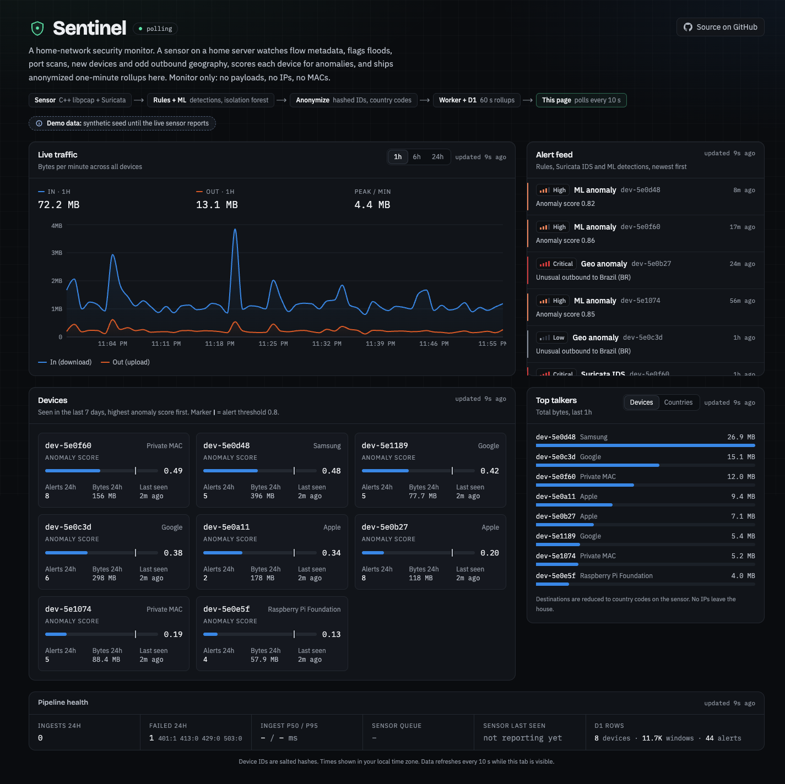
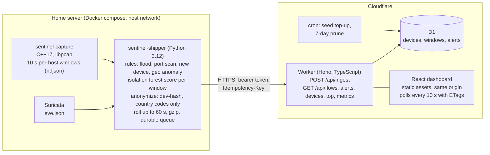

# Sentinel

**A home-network security monitor I run on my own LAN: C++ libpcap sensor, Suricata, an isolation-forest anomaly score, and an anonymized public dashboard on Cloudflare Workers + D1.**

[](https://github.com/SolomonSmith-dev/sentinel/actions/workflows/ci.yml)
[](LICENSE)


**Live dashboard: https://sentinel.solomonsmith.dev**

The home sensor reports live anonymized telemetry. Earlier synthetic demo history remains visible and labeled during the transition. Monitor only. No payloads are stored, and IP addresses and MAC addresses stay on the sensor; common local DNS names are rejected or redacted before shipping.



<sub>Desktop view of the live dashboard (synthetic demo data). A [mobile capture](docs/images/dashboard-mobile.png) is also in the repo.</sub>

## Why I built this

I self-host. A Debian home server runs my own services: Pi-hole for DNS, media, and an AI agent stack. Once a network carries that much, "the router seems fine" is not a security posture.

I wanted a tool I control to watch it. Not a cloud camera. Not a subscription that ships my traffic to someone else. So the sensor runs on my hardware, and the only thing that leaves the house is a salted-hash device ID, byte counts and country codes.

It also let me put three things I am studying into one system: systems work (C++ and libpcap), machine learning (an isolation forest with no labels), and edge cloud (Workers and D1 on the free tier). I do not have measured detection rates on real traffic yet. The numbers in [`ml/README.md`](ml/README.md) are labeled synthetic, and the limits are written down next to them.

## Architecture



The public URL never reaches into the LAN. The sensor pushes out; nothing on the home network accepts inbound connections for this.

## Privacy by design

- Devices are `dev-` plus the first 6 hex characters of `sha256(mac + salt)`. The salt is generated on the sensor host and never leaves it.
- Remote endpoints are reduced to ISO country codes on the sensor.
- The shipper refuses to send any batch containing an IP or MAC pattern, and the Worker independently rejects such batches (`400 pii_rejected`), checking both the raw body and the decoded JSON.
- No packet payloads are captured (128-byte snaplen, headers only) or stored anywhere.

## What it detects

| Detection | Rule |
|---|---|
| Flood | More than 2000 packets/s to one destination, or more than 500 SYNs without ACK in 10 s |
| Port scan | One source touches more than 20 distinct destination ports in 10 s (either direction) |
| New device | Hashed MAC not seen before |
| Geo anomaly | Outbound traffic to a country this device has not contacted in the trailing 7 days (quiet during a device's first 24 h) |
| ML anomaly | Isolation-forest score above 0.8 on bytes in/out, packets, distinct destinations, distinct ports and SYN ratio |
| Suricata | ET Open rule hits from eve.json, mapped to the device hash |

See `ml/README.md` for why an isolation forest (no labels exist on a home LAN), how raw scores map to [0, 1], and the evaluation `ml/train.py` prints on synthetic injected anomalies.

## Engineering highlights

- **Bounded-memory capture.** Per-host state lives for one 10 s window, then is dropped. Hard caps (4096 hosts, 1024 dests and 1024 inbound sources per host, 262144 peer entries per window) stop spoofed MACs or addresses from growing memory. Distinct counts stay exact under a fixed 8 KiB per-host port bitset. See [`sensor/capture/README.md`](sensor/capture/README.md).
- **Exact pcap replay tests.** The real binary runs against three deterministic fixtures (port scan, SYN flood, benign) and the counts are asserted exactly, not approximately. The parser is also tested at every truncation length of several frames.
- **Defensive parsing.** All reads go through a bounds-checked cursor; VLAN/QinQ and IPv6 extension headers are handled with capped walks; windows are published atomically (`.tmp`, `fsync`, `rename`).
- **Crash-safe ML loading for an old CPU.** The sensor host is a 2-core Core 2 Duo without SSE4.2, POPCNT or AVX. A numpy wheel using those instructions kills the interpreter with SIGILL at import, which cannot be caught in-process. In `auto` mode the shipper first runs the import and a tiny fit in a child process, and falls back to rules-only if it dies.
- **Calibrated anomaly score.** Raw isolation-forest scores shift on every retrain, so they are mapped to [0, 1] with the training median at 0.5 and the 99.9th percentile at 0.8. The alert threshold stays meaningful across nightly retrains. See [`ml/README.md`](ml/README.md).
- **Idempotent gzip ingest with PII rejection.** The `Idempotency-Key` is the sha256 of the uncompressed body, which the Worker recomputes. Replays within 24 hours return `duplicate` and write nothing. Raw and decompressed size caps handle gzip bombs, and the PII check runs on both the raw body and the decoded JSON.
- **Crash-safe shipping.** An on-disk queue with backoff removes a batch only after the API accepts it. Commit order in the pipeline is chosen so a crash replays work instead of losing it.
- **D1 write-budget engineering.** D1 counts each index entry as a row written against a 100k/day free-tier cap. Sentinel ships 60 s rollups instead of 10 s windows, skips idle devices, re-sends device metadata at most every 10 minutes and keeps one secondary index on `windows`.
- **Written down, not hidden.** [`docs/qa-findings.md`](docs/qa-findings.md) is a ranked security and quality review of the project with proofs, including the issues it found in the ingest path.

## Testing

| Suite | Command | What it proves |
|---|---|---|
| API (vitest on the Workers runtime) | `cd api && npm test` | Ingest auth, size caps, idempotency, PII rejection, read endpoints. 80 tests passed on 2026-10-25. |
| Shipper (pytest) | `cd sensor/shipper && .venv/bin/pytest -q` | Rules, eve.json tail, anonymizer, privacy guard, rollup, queue, ML mode. 158 tests passed on 2026-10-25. |
| Capture (ctest) | `ctest --test-dir build --output-on-failure` | Parser unit tests plus exact-value replays of three pcap fixtures. 4 of 4 passed on 2026-10-25. |
| Dashboard | `cd dashboard && npm run build` | Production build, run in CI. |
| Deploy script | `shellcheck deploy-sensor.sh` | Run in CI. |

CI runs on every push to `main` (badge above). Build steps for the capture binary are in [`sensor/capture/README.md`](sensor/capture/README.md).

## Repository layout

| Path | What | Tests |
|---|---|---|
| `sensor/capture/` | C++17 libpcap capture: Ethernet/VLAN/IPv4/IPv6/TCP/UDP parsing, per-host 10 s windows, bounded memory, atomic file output, pcap replay mode | ctest: parser unit tests plus exact-value replays of three pcap fixtures (port scan, SYN flood, benign) |
| `sensor/shipper/` | Python shipper: rules, Suricata eve.json tail, geo lookup, anonymizer, privacy guard, rollup, on-disk queue with backoff, nightly retraining | pytest |
| `ml/` | Offline isolation-forest trainer and evaluator, with the reasoning behind features and calibration | `ml/train.py` |
| `api/` | Cloudflare Worker: authenticated ingest with size caps, rate limit, idempotency, PII rejection; read endpoints with ETag and edge caching; D1 migrations; cron jobs | vitest on the Workers runtime |
| `dashboard/` | Vite + React + TypeScript + Recharts + Tailwind | build in CI |
| `docs/api.md` | The API contract every component codes to | |
| `docs/sensor-format.md` | The capture to shipper file format | |
| `deploy-sensor.sh` | One-command sensor deploy on the home server | shellcheck in CI |

## Run it

Cloud side (needs a Cloudflare account; free tier):

```sh
cd api && npm ci
npx wrangler d1 create sentinel        # put the id in wrangler.jsonc
npx wrangler d1 migrations apply sentinel --remote
openssl rand -hex 32 | npx wrangler secret put SENTINEL_TOKEN
cd ../dashboard && npm ci && npm run build
cd ../api && npx wrangler deploy
```

Sensor side (Debian with Docker, on a box that sees LAN traffic):

```sh
git clone https://github.com/SolomonSmith-dev/sentinel && cd sentinel
mkdir -p ~/.config/sentinel && (umask 077; echo '<token>' > ~/.config/sentinel/token)
./deploy-sensor.sh --dry-run && ./deploy-sensor.sh
```

Kill switches: `docker compose -f sensor/docker-compose.yml down` on the sensor, or set the Worker var `INGEST_ENABLED=false`.

## Free-tier limits

D1 allows 100k rows written per day and counts each index entry as a write. Sentinel ships 60 s rollups (not 10 s windows), skips idle devices, re-sends device metadata at most every 10 minutes and keeps one secondary index on `windows`. Data older than 7 days is pruned nightly.

## Roadmap

- R2 archive of windows beyond 7 days
- Cloudflare Queues between ingest and storage
- Push/email notifications on high-severity alerts
- Server-sent events instead of polling
- Sharding D1 by device hash if a larger network outgrows one database

## License

MIT
